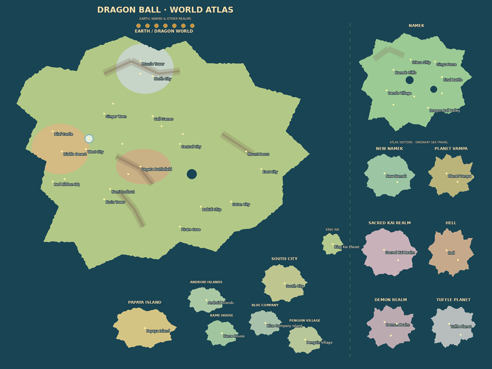
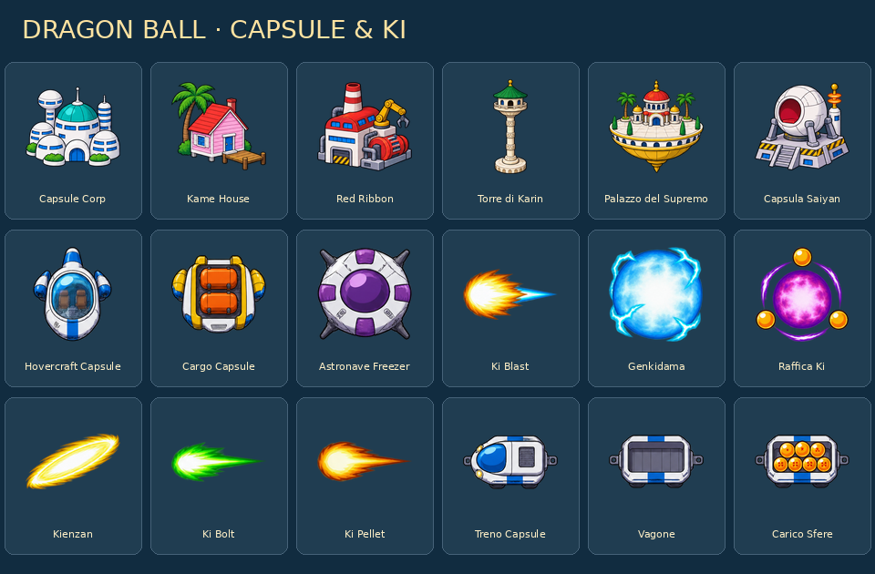

# Dragon Ball · World Atlas

Mappa fan di Dragon Ball e skin personale **Dragon Ball · Capsule & Ki**.
Terreno, livelli e 18 sprite sono originali di questo fork, senza texture,
loghi, musica o immagini estratte da manga, anime o giochi.



## Utilizzo

Scegliere **Dragon Ball · World Atlas** tra le mappe `New` / `Fictional` nella
lobby privata o nel singleplayer. Nel selettore delle skin scegliere
**Dragon Ball · Capsule & Ki**. La skin può essere usata anche su altre mappe;
ogni partecipante sceglie la propria e gli altri ne vedono la scelta.
Bot, nazioni e God seguono il tema locale secondo il comportamento esistente.

La mappa ha peso zero nelle rotazioni pubbliche. La grafica e i nomi usano le
normali regole OpenFront: nessun bonus di potenza, trasformazione, volo o raccolta
sfere viene aggiunto alla simulazione. Le sfere nel titolo dell'atlante e nel
vagone sono decorative. Per God resta valido il limite di un MIRV alla volta.

## Mappa

Terreno **1920 × 1440**, Compact **960 × 720**. La Terra occupa l'area principale:
West City e Capsule Corporation, Central City, East City, Ginger Town, Cell Games,
Muscle Tower, Torre di Karin, Palazzo del Supremo, Monte Paozu, Satan City,
Red Ribbon HQ, Babidi Ship, Papaya Island, Kame House e Penguin Village.

I settori a destra rappresentano Namek, New Namek, Vampa, il mondo dei Kai,
l'Aldilà, il Demon Realm e il pianeta Tsufuru. Il piccolo pianeta di Re Kaioh
è distinto dal regno dei Kaioshin. Sono **settori di un atlante**, non continenti
fisicamente vicini alla Terra: le distanze e le coste sono adattate al gioco.
I collegamenti usano il normale mare navigabile OpenFront, senza portali.

Due livelli opzionali forniscono colori dei mondi, un piccolo riferimento a
Capsule Corp e titoli sull'acqua. La preview aggiunge nomi delle località per
orientarsi; il layer runtime non copre le unità con questi nomi geografici.

Geometria editabile: [`scripts/maps/create_dragonball.py`](../scripts/maps/create_dragonball.py).
Catalogo avversari: [`scripts/maps/dragonball_enemies.json`](../scripts/maps/dragonball_enemies.json).

## Avversari

**54 presidi regionali** rappresentano le saghe: Pilaf nel suo castello,
Commander Red nella base Red Ribbon, General White a Muscle Tower,
King Piccolo a Central City, Dr. Gero nel laboratorio, Cell ai Cell Games,
Nappa a East City, Raditz alla Kame House, Freezer e la squadra Ginyu su Namek,
Majin Bu e i nemici delle altre saghe nei rispettivi settori.

Il catalogo ha **494 etichette uniche**, di cui **302 nomi di avversari o forme**
e **192 squadre numerate** di tipi di truppe esistenti. Le 440 etichette mobili
comprendono 248 nomi/formazioni personali e le 192 squadre. Le squadre sono
etichette RTS, ad esempio `Frieza Soldier Squad 24`: non sono presentate come
192 nuovi personaggi della storia. Il catalogo copre 400 bot e 400 nazioni senza
ricorrere ai nomi generici delle altre mappe.

Sono inclusi antagonisti, forme incontrate, ex nemici e avversari di torneo.
Originale, Z, film, GT, Super e Daima sono rappresentati insieme come atlante fan;
non si afferma che tutti appartengano a un'unica continuità. Alcuni presidi sono
rappresentativi dell'area o della saga, senza ricostruire un singolo momento
cronologico. I nomi restano in inglese per coerenza con il catalogo del gioco.
Selezione e posizionamento usano il PRNG deterministico esistente.

## Skin



File finali: [`resources/skins/dragonball/`](../resources/skins/dragonball/).
Tutti sono PNG RGBA **128 × 128** con margini trasparenti. Generati con la skill
ImageGen e lo strumento integrato; prompt esatti in
[`dragonball-image-prompts.json`](dragonball-image-prompts.json).
La preparazione meccanica isola i soggetti, rimuove il rumore alpha quasi nullo
della codifica e li centra in celle uniformi.

| Elemento       | File                      | Aspetto                        |
| -------------- | ------------------------- | ------------------------------ |
| Città          | `city.png`                | Edifici e cupola Capsule Corp  |
| Porto          | `port.png`                | Kame House con piccolo pontile |
| Fabbrica       | `factory.png`             | Officina robotica Red Ribbon   |
| Difesa         | `defensePost.png`         | Torre di Karin                 |
| SAM            | `samLauncher.png`         | Palazzo del Supremo            |
| Silo           | `missileSilo.png`         | Capsula Saiyan su piattaforma  |
| Trasporto      | `transportship.png`       | Hovercraft Capsule             |
| Mercantile     | `tradeship.png`           | Cargo Capsule                  |
| Nave da guerra | `warship.png`             | Astronave stile Freezer        |
| Atomica        | `atombomb.png`            | Ki Blast                       |
| Bomba H        | `hydrogenbomb.png`        | Genkidama                      |
| MIRV           | `mirv2.png`               | Raffica di Ki                  |
| Missile SAM    | `samMissile.png`          | Kienzan                        |
| Proiettile     | `shell.png`               | Ki Bolt                        |
| Testata MIRV   | `mirvWarhead.png`         | Ki Pellet                      |
| Locomotiva     | `trainEngine.png`         | Treno Capsule                  |
| Vagone         | `trainCarriage.png`       | Vagone Capsule                 |
| Vagone carico  | `trainCarriageLoaded.png` | Carico di sfere                |

Il quinto pacchetto è la riga 4 degli atlas. Le quattro righe precedenti
(Flower Power, Warcraft, Default, FFVII Mako) restano identiche pixel per pixel.
Atlas unità **1536 × 640**, edifici **768 × 640**; ingombri e buffer per istanza
non cambiano. Menu, pannelli avversari, anteprime, God e replay usano il medesimo
identificativo `dragonball`.

## Rigenerazione e verifiche

Dalla radice del repository:

```sh
python scripts/maps/create_dragonball.py
cd map-generator
go run . --maps=dragonball
cd ..
go run scripts/skins/build_atlases.go
```

Python/Pillow servono solo a generare la mappa sorgente; il map-generator usa Go.
Binari, PNG e thumbnail sono inclusi: Docker/Render non esegue ImageGen, Go o
Pillow per distribuire la mappa. Non scarica riferimenti o bestiari in build.

I test usano i veri binari runtime Normal/Compact: spawn, separazione dei settori,
mare oceanico, avvio e avanzamento di una partita, 400 bot deterministici e
400 nazioni del catalogo. La skin è verificata anche in protocollo, server,
selettore, HUD, God e buffer dei pass reali. La build verifica gli asset con hash.
Non è stata eseguita una partita completa nel browser su Render né un deploy.

## Riferimenti

- [West City — sito ufficiale](https://en.dragon-ball-official.com/news/01_551.html)
- [Kame House — sito ufficiale](https://en.dragon-ball-official.com/news/01_799.html)
- [Central City — sito ufficiale](https://en.dragon-ball-official.com/news/01_203.html)
- [Ginger Town — sito ufficiale](https://en.dragon-ball-official.com/news/01_314.html)
- [Cell — sito ufficiale](https://en.dragon-ball-official.com/news/01_158.html)
- [Indice degli antagonisti delle serie](https://dragon-ballwiki.com/wiki/list-of-manga-and-anime-antagonists/)
- [Indice degli antagonisti dei film](https://dragon-ballwiki.com/wiki/list-of-film-antagonists/)

Dragon Ball è un'opera di Akira Toriyama; i marchi e i personaggi appartengono
ai rispettivi titolari. Mappa e skin sono un adattamento fan non ufficiale.
