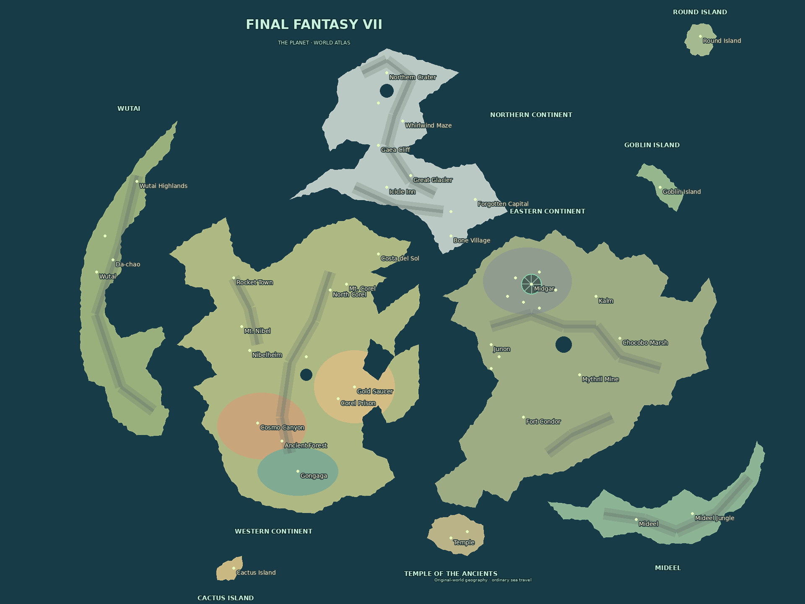
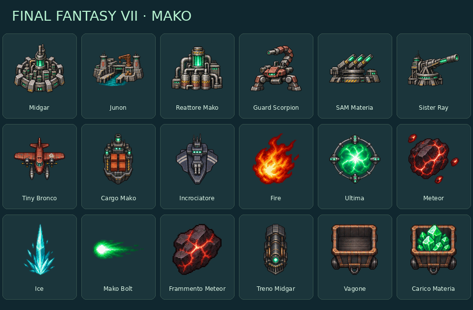

# Final Fantasy VII · The Planet

Mappa fan originale del mondo di FFVII e skin **Final Fantasy VII · Mako**.
Geografia e nomi richiamano il gioco; terreno e sprite sono asset creati per questo
fork, senza texture, loghi, musiche o sprite estratti dai giochi Square Enix.



## Come usarli

Nella lobby privata o nel singleplayer scegliere **Final Fantasy VII · The Planet**
tra le mappe `New` / `Fictional`. Nel selettore della skin scegliere
**Final Fantasy VII · Mako**. La skin è disponibile anche sulle altre mappe:
la scelta resta personale, sincronizzata dal server prima dell'avvio.
Gli avversari umani mostrano la propria scelta; bot, nazioni e il giocatore God
seguono il pacchetto del visualizzatore, come per le skin esistenti.

La mappa ha peso zero nelle rotazioni pubbliche. Usa le normali regole OpenFront:
nomi dei boss e grafica non aggiungono abilità, statistiche o modificatori segreti.

## Geografia e nemici

Terreno **1920 × 1440**, anche in modalità Compact **960 × 720**. Comprende
continenti orientale, occidentale e settentrionale, Wutai, Mideel, il Tempio degli
Antichi, Goblin Island, Round Island e Cactus Island. L'interpretazione segue la
geografia del gioco originale: il Tempio rimane a sud, non nella posizione di Rebirth.
Le sagome sono semplificate per il gioco territoriale; rilievi attaccabili, nessun
muro invisibile e mari attraversabili con i trasporti normali.

I due livelli opzionali aggiungono colori regionali, un piccolo simbolo di Midgar
e titoli geografici sull'acqua. Non cambiano il terreno né il movimento.
L'anteprima in questa pagina aggiunge i nomi delle località per orientarsi.

**46 presidi regionali** usano nemici e personaggi affrontati nella storia:
President Shinra a Midgar, Rufus alla sede Shinra, Reno al Settore 7,
Guard Scorpion al Reattore 1, Midgar Zolom nella palude, Carry Armor al reattore
sottomarino, Dyne nella prigione di Corel, Gi Nattak a Cosmo Canyon,
Materia Keeper sul Monte Nibel, Godo a Wutai, Sephiroth al Cratere Nord.
Dio è presente come avversario dell'arena in Rebirth. Alcune presenze sono
rappresentative dell'area: Master Tonberry a Round Island e i nemici della Gelnika
nel catalogo mobile; non si inventano presidi terrestri per il sottomarino.

Altri **509 nomi unici** provengono dai bestiari di FFVII, Remake e Rebirth.
Il catalogo complessivo contiene **555 nomi**, coprendo la configurazione massima
di 400 nazioni e quella di 400 bot senza nomi generici. Nomi delle forme e
varianti restano distinti; la selezione usa il PRNG deterministico esistente.
Non viene modificata la logica degli acquisti o dei nomi forniti dal server.

Catalogo editabile: [`scripts/maps/ff7_enemies.json`](../scripts/maps/ff7_enemies.json).
Sagome, rilievi e posizioni: [`scripts/maps/create_ff7.py`](../scripts/maps/create_ff7.py).

## Skin Mako



I file finali sono in [`resources/skins/ff7-mako/`](../resources/skins/ff7-mako/):
PNG RGBA **128 × 128**, con margini trasparenti. Artwork generato con la skill
ImageGen e lo strumento integrato; prompt esatti e rifinitura alpha sono salvati in
[`ff7-image-prompts.json`](ff7-image-prompts.json).
La preparazione meccanica ritaglia i singoli soggetti, azzera il rumore alpha
quasi trasparente e li centra in celle uniformi; non richiede strumenti AI in build.

| Elemento       | File                      | Richiamo visivo             |
| -------------- | ------------------------- | --------------------------- |
| Città          | `city.png`                | Midgar con piastre radiali  |
| Porto          | `port.png`                | Fortezza navale di Junon    |
| Fabbrica       | `factory.png`             | Reattore Mako               |
| Difesa         | `defensePost.png`         | Torretta Guard Scorpion     |
| SAM            | `samLauncher.png`         | Batterie di materia verde   |
| Silo           | `missileSilo.png`         | Cannone Sister Ray          |
| Trasporto      | `transportship.png`       | Tiny Bronco su galleggianti |
| Mercantile     | `tradeship.png`           | Cargo industriale Mako      |
| Nave da guerra | `warship.png`             | Incrociatore di Junon       |
| Atomica        | `atombomb.png`            | Fire                        |
| Bomba H        | `hydrogenbomb.png`        | Ultima                      |
| MIRV           | `mirv2.png`               | Meteor con frammenti        |
| Missile SAM    | `samMissile.png`          | Ice                         |
| Proiettile     | `shell.png`               | Scarica Mako                |
| Testata MIRV   | `mirvWarhead.png`         | Frammento di Meteor         |
| Locomotiva     | `trainEngine.png`         | Treno di Midgar             |
| Vagone         | `trainCarriage.png`       | Carrello industriale        |
| Vagone carico  | `trainCarriageLoaded.png` | Materia verde               |

La riga 3 degli atlas condivisi contiene il nuovo pacchetto. Le righe 0–2
(Flower Power, Warcraft, Default) restano identiche pixel per pixel.
Dimensioni atlas: unità **1536 × 512**, edifici **768 × 512**. Colonne, ingombri,
buffer e segnali di combattimento mantengono il contratto esistente. Menu,
pannelli, anteprime, God e replay usano lo stesso identificativo `ff7-mako`.

## Rigenerazione e controlli

Dalla radice del repository:

```sh
python scripts/maps/create_ff7.py
cd map-generator
go run . --maps=finalfantasyvii
cd ..
go run scripts/skins/build_atlases.go
```

La geometria richiede Python e Pillow; la conversione usa il map-generator Go
ufficiale del progetto. Docker/Render usa direttamente i binari e PNG inclusi.
Nessun download di bestiari, mappe di riferimento o generazione AI avviene in build.

I test caricano i binari runtime effettivi, controllano posizioni Normal/Compact,
separazione dei continenti, mare oceanico, avvio e avanzamento di una simulazione,
400 bot deterministici e 400 nazioni con nomi del catalogo. I controlli delle skin
coprono protocollo, conferma server, selettore, HUD, God e buffer dei pass reali.
I file sono inclusi nel manifest asset con hash. Non è stata eseguita una partita
completa nel browser su Render né un deploy.

## Riferimenti

- [Atlante del mondo originale e località](https://www.ffonline.com/ff7/world)
- [Località del mondo originale](https://www.finalfantasykingdom.net/finalfantasyviiworldmap.php)
- [Descrizione ufficiale delle regioni e dei mezzi in Rebirth](https://www.square-enix.com/ffvii/en-us/games/rebirth/world/)
- [Bestiario originale](https://shrines.rpgclassics.com/psx/ff7/enemies2.shtml)
- [Enemy Intel Remake](https://www.powerpyx.com/final-fantasy-7-vii-remake-all-enemies-weaknesses-list/)
- [Enemy Intel Rebirth](https://www.powerpyx.com/final-fantasy-7-vii-rebirth-all-enemies-list/)

Final Fantasy VII è una proprietà di Square Enix. Mappa e skin sono un adattamento
fan non ufficiale. L'attribuzione è riportata anche in `CREDITS.md`.
