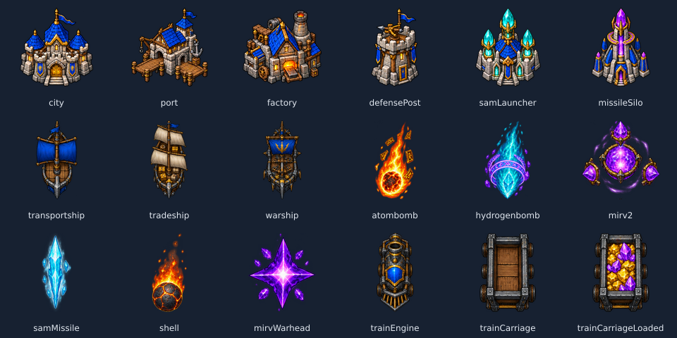

# Warcraft Fantasy

Pacchetto originale di **18 sprite** ispirato ai giochi fantasy RTS di Warcraft:
pietra grigia, travi di legno, tetti blu, metallo e magie arcane. Artwork generato
con la skill ImageGen e lo strumento integrato, non estratto dai giochi Blizzard.
È una skin fan non ufficiale. Le meccaniche e i nomi delle unità non cambiano.



## Scelta e sincronizzazione

Il selettore è nella lobby dell'host, nella lobby di chi entra e nelle impostazioni
singleplayer. Mostra le anteprime di Flower Power e Warcraft Fantasy. La scelta
riguarda le unità del giocatore: non sostituisce il tema degli altri partecipanti.

In multiplayer, il server accetta soltanto gli identificativi dei due pacchetti
integrati e soltanto prima di prestart. Non vengono accettati URL arbitrari. La
scelta entra nel roster e nei cosmetici del messaggio di avvio; viene quindi
visualizzata dagli altri client e conservata nel record/replay. Restano valide
le regole esistenti di anonimizzazione e visibilità dei cosmetici. Il pacchetto
è gratuito, utilizzabile dagli ospiti self-hosted e separato dalle skin
territoriali del catalogo account.

La preferenza viene salvata nel browser dopo la conferma del server e riutilizzata
nelle partite successive e dopo una riconnessione. Se lo storage è bloccato, la
scelta resta disponibile nella sessione. In singleplayer è salvata direttamente.
La GUI mostra salvataggio, rifiuto durante l'avvio e riprova dopo un timeout.

Le unità senza un proprietario con questa skin, comprese AI e il giocatore God
condiviso dagli spettatori, mantengono Flower Power. Uno spettatore non possiede
unità personali: la sua selezione vale quando parteciperà come giocatore.
Esplosioni, terreno e interfaccia generale mantengono gli effetti esistenti.

## Asset e rigenerazione

Le sorgenti finali sono i 18 PNG RGBA da 128 × 128 in
[`resources/skins/warcraft/`](../resources/skins/warcraft/), con alpha reale.
La suddivisione e il ridimensionamento delle immagini generate sono passaggi
meccanici eseguiti con Sharp; i file finali sono inclusi nel repository e non
richiedono le immagini di lavoro. Il manifest registra i due ordini di colonne.

| Unità originale      | Sprite                    | Aspetto                        |
| -------------------- | ------------------------- | ------------------------------ |
| Città                | `city.png`                | Municipio fortificato          |
| Porto                | `port.png`                | Approdo in pietra e legno      |
| Fabbrica             | `factory.png`             | Forgia nanica                  |
| Postazione difensiva | `defensePost.png`         | Torre con ballista             |
| Lanciatore SAM       | `samLauncher.png`         | Torre di cristalli di ghiaccio |
| Silo missilistico    | `missileSilo.png`         | Torre arcana                   |
| Trasporto            | `transportship.png`       | Barca con vela blu             |
| Nave mercantile      | `tradeship.png`           | Veliero con casse              |
| Nave da guerra       | `warship.png`             | Galea corazzata                |
| Bomba atomica        | `atombomb.png`            | Palla di fuoco                 |
| Bomba all'idrogeno   | `hydrogenbomb.png`        | Cometa arcana                  |
| MIRV                 | `mirv2.png`               | Globo di cristalli             |
| Missile SAM          | `samMissile.png`          | Lancia di ghiaccio             |
| Proiettile           | `shell.png`               | Pietra incandescente           |
| Testata MIRV         | `mirvWarhead.png`         | Scheggia arcana                |
| Locomotiva           | `trainEngine.png`         | Locomotiva nanica              |
| Vagone               | `trainCarriage.png`       | Carrello minerario             |
| Vagone carico        | `trainCarriageLoaded.png` | Carrello con oro e cristalli   |

Gli atlas condivisi sono `resources/atlases/unit-skins.png` (1536 × 256) e
`resources/atlases/icon-skins.png` (768 × 256). Riga 0: Flower Power, identica
pixel per pixel agli atlas originali. Riga 1: Warcraft. Gli slot e gli ingombri
sulla mappa sono conservati. Le dimensioni del buffer per istanza non aumentano:
l'indice memorizza colonna e riga; lo shader ricava la colonna originale per
forme, effetti, evidenziazioni e segnali di combattimento. Anche le anteprime di
costruzione, il menu costruzioni e gli sprite HUD usano la scelta appropriata.

Per ricostruire gli atlas dalle sorgenti, dalla radice del repository:

```sh
go run scripts/skins/build_atlases.go
```

Serve solo la libreria standard Go. La build Docker/Render usa i PNG inclusi e
non richiede né Go né Sharp.

## Verifica

Test del protocollo binario, accettazione/rifiuto lato server, anonimizzazione,
preferenza/riconnessione, selettore, singleplayer, replay e buffer reali dei due
pass grafici. Gli shader reali sono compilati e collegati su OpenGL ES 3.2 Mesa.
Il controllo degli asset verifica alpha, dimensioni, tutte le 18 celle e identità
pixel per pixel della riga Flower Power. Una partita completa nel browser su
Render non è stata eseguita.

## Prompt ImageGen

Generazione con lo strumento integrato, sfondo trasparente, seguita da ritaglio,
ridimensionamento e confezionamento degli atlas. Nessun modello CLI/API esterno.

### Unità

```text
Use case: stylized-concept. Asset type: production sprite sheet for a top-down 2D strategy game, Warcraft-inspired high fantasy RTS. Create ONE transparent sheet with exactly 12 isolated mobile unit sprites in a STRICT 4-column by 3-row evenly spaced grid, all 12 cells equal size. No text, no labels, no grid lines, no scenery, no water or ground behind objects, true transparent alpha, no watermark. Each complete object centered in its cell, at most 60% cell width and height, generous transparent gutters, absolutely no overlaps. Chunky hand-painted pixel-inspired fantasy RTS art reminiscent of Warcraft II/III, readable tiny silhouettes, steel and dark wood with restrained gold trim, cobalt blue sails, magical teal/purple/orange accents, dark near-black outlines. Mostly top-down view, consistent orientation upward, simple coherent detail. Order left to right top to bottom: ROW 1: (1) wooden transport boat, one blue square sail and steel bow, (2) merchant ship with two tan sails and gold cargo crates, (3) ironclad fantasy war galley with blue banner and a ballista, (4) blazing orange fireball spell with small golden rune fragments replacing atomic missile. ROW 2: (5) large turquoise arcane comet with glowing purple rune ring replacing hydrogen bomb, (6) radiant purple soul crystal orb surrounded by exactly three smaller purple crystals replacing MIRV, (7) small cyan ice lance pointing upward replacing SAM missile, (8) small orange glowing cannon stone replacing shell. ROW 3: (9) small purple star-shaped arcane shard replacing MIRV warhead, (10) dwarven iron steam locomotive top-down with a blue crest, (11) wooden armored mine cart top-down, (12) wooden mine cart loaded with bright gold and purple crystals top-down. These must be usable separated sprites rather than an illustration. Maintain identical visual style, camera and scale logic. Original fan-game art: no copied game assets, no existing logos or lettering.
```

### Edifici

```text
Use case: stylized-concept. Asset type: production BUILDING ICON sprite sheet for a top-down 2D strategy game. Warcraft-inspired high fantasy RTS artwork. ONE truly transparent sheet with exactly 6 isolated building sprites in a STRICT 3-column by 2-row evenly spaced grid, equal-sized cells. Every object centered in its own cell, fits within 60% width and 60% height, very generous transparent gutters, no overlaps. No text, no lettering, no labels, no grid lines, no scenery, no ground tiles or background, no watermark, no cast shadows outside object. Art style: chunky beautifully hand-painted pixel-inspired Warcraft II/III fantasy RTS, very readable 64px silhouettes, weathered gray stone, dark timber beams, rich cobalt blue roofs and banners, warm gold trim, tiny violet/teal magic highlights, crisp dark near-black outlines. Slightly elevated 3/4 top-down camera matching classic RTS building icons. Exact order left to right top to bottom: ROW 1: (1) CITY: compact fortified medieval town hall with three blue roofs and a golden central doorway; (2) PORT: sturdy stone-and-timber harbor with two wooden piers, blue roof and iron anchor, no water background; (3) FACTORY: dwarven forge workshop with thick stone walls, blue gabled roof, one stout chimney and a glowing orange forge opening. ROW 2: (4) DEFENSE POST: short crenellated stone guard tower with one blue pennant and a tiny ballista; (5) SAM LAUNCHER: frost mage tower with three tall glowing teal crystals mounted around a blue-roofed stone base; (6) MISSILE SILO: tall rune-carved arcane tower with a purple crystal spire, small golden rune circle and cobalt blue buttresses. Original fan-game art rather than pasted assets. No real Warcraft faction logos. Use varied clear silhouettes and chunky proportions that survive shrinking.
```

### Rifinitura alpha degli edifici

```text
Use case: background-extraction. Edit target: the six fantasy buildings in the supplied 3-column by 2-row sprite sheet. Remove ONLY the cloudy brown/gray/blue background, haze, ambient colored glow behind the objects, and every external cast shadow. Every pixel outside the six isolated buildings must have alpha zero: corners, entire outer border, and gutters between all six sprites must be fully transparent. Preserve the six building designs, exact arrangement, size, orientation, blue roofs, stone blocks, gold trim, windows, and architectural detail. Keep bright luminous crystals and illuminated parts attached to buildings, but NO haze behind them. The buildings themselves should have opaque surfaces with clean dark outlines and antialiasing only on the actual edges. This must be a production game sprite sheet on real clean alpha, not an illustration on a dark background, no checkerboard painted into the image. No new symbols, no text, no new objects.
```
